# Capítulo 4 — Entity Manipulation Language (EML)

> Resumen en español del capítulo 4 de *ABAP RESTful Application Programming Model*, 2ª ed. (Rheinwerk, 2025).
> Los diagramas están en **Mermaid**: se ven en GitHub, en VS Code (con extensión Mermaid) y en la mayoría de visores Markdown.
> Los fragmentos EML son **esqueletos mínimos** para reconocer la sintaxis, no programas completos.

---

## 🗺️ El capítulo en una imagen

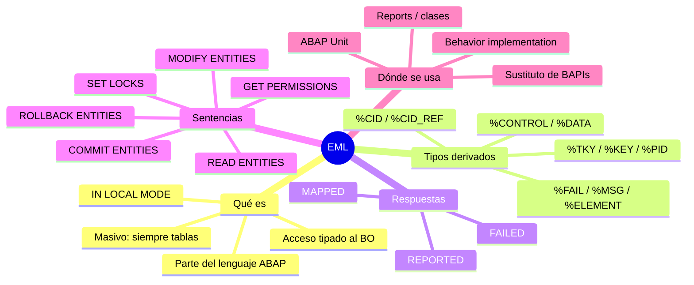

---

## 1. ¿Qué es EML?

**EML = el "SQL" de los business objects RAP**, pero integrado en ABAP. Con él lees y modificas instancias de un BO de forma **tipada**, usando solo las operaciones declaradas en la behavior definition.

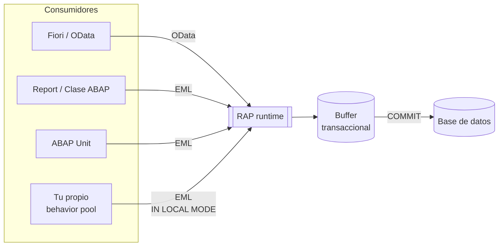

**Las 4 ideas clave**

| 💡 | Idea |
|---|---|
| 📋 | **Siempre masivo**: todas las operaciones trabajan con tablas de instancias (aunque sea una). |
| 🧠 | **Lee el buffer transaccional**, no la BD → ves datos aún no grabados. Ese es su gran valor frente a `SELECT`. |
| 🔒 | Solo puedes usar lo **declarado en la BDEF**. No hace falta service definition ni binding. |
| 🏠 | **`IN LOCAL MODE`**: solo dentro del behavior pool del propio BO. Salta autorizaciones, feature control y restricciones de campo (`readonly`…). |

**Doble vida de EML**

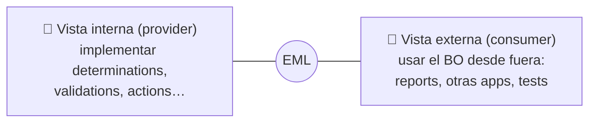

---

## 2. Tipos derivados — los campos `%`

El compilador genera **tipos automáticamente** a partir de la BDEF. Además de los campos de la entidad, llevan componentes técnicos que empiezan por **`%`** (para no chocar con tus campos).

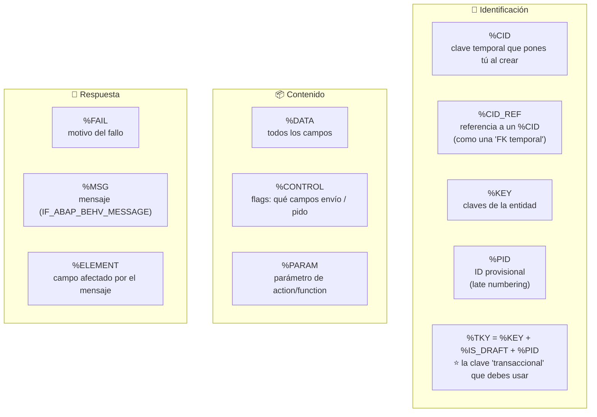

### ¿Cómo encajan %CID y %CID_REF?

Crear un padre y sus hijos **en una sola llamada** (todavía no existen claves reales):

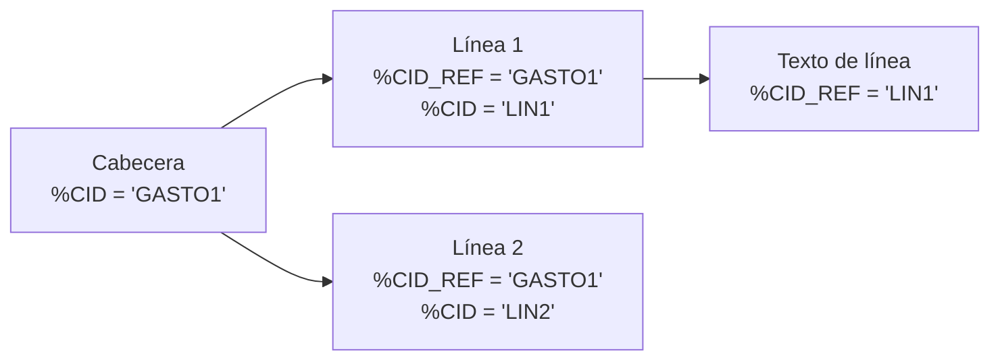

> 📌 El `%CID` debe ser **único** dentro de la llamada. Con **`AUTO FILL CID`** RAP lo genera por ti.

### %TKY — usa siempre este

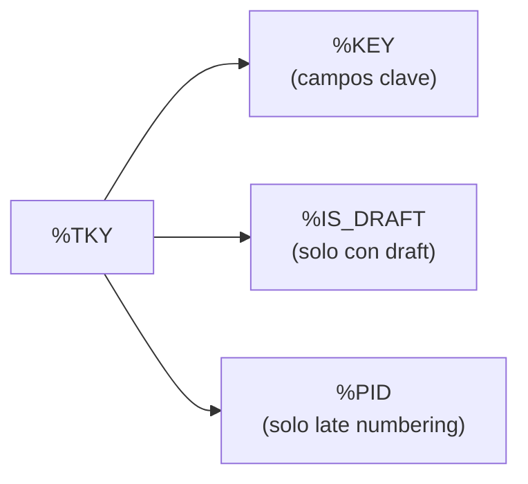

> ✅ Si usas `%TKY` tu código funciona igual con o sin draft y con o sin late numbering.

---

## 3. Parámetros de respuesta: FAILED · REPORTED · MAPPED

Son tablas anidadas con **una tabla por entidad** de la BDEF.

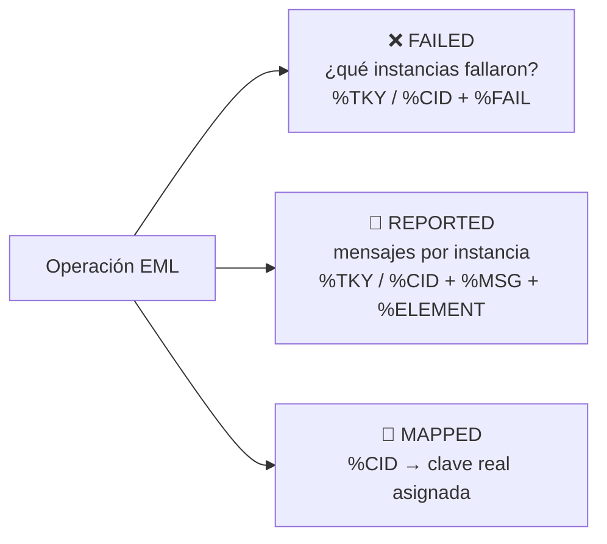

**¿Qué rellena cada sentencia?**

| Sentencia | FAILED | REPORTED | MAPPED |
|---|:-:|:-:|:-:|
| `READ ENTITIES` | ✅ | ✅ | – |
| `MODIFY ENTITIES` | ✅ | ✅ | ✅ |
| `GET PERMISSIONS` | ✅ | ✅ | – |
| `SET LOCKS` | ✅ | ✅ | – |
| `COMMIT ENTITIES` | ✅ | ✅ | – |
| `ROLLBACK ENTITIES` | ✅ | ✅ | – |

> 📌 **MAPPED solo aparece al modificar**: es cuando se crean instancias y hay que decirte qué clave le tocó a cada `%CID`.

---

## 4. Las 6 sentencias EML

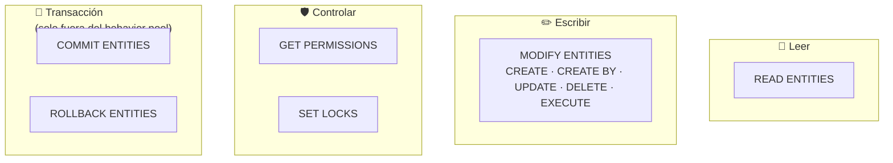

### 4.1 READ ENTITIES 📖

Lee del **buffer transaccional** (si no está ahí, RAP va a la BD).

```
READ ENTITIES OF <BO raíz> [IN LOCAL MODE]
  ENTITY <alias>
    FIELDS ( campo1 campo2 ) | ALL FIELDS
    WITH <tabla de claves>
  RESULT DATA(lt_result)
  [BY \_asociación …]          " leer hijos/padre
  FAILED … REPORTED … .
```

| Variante | Para qué |
|---|---|
| `FIELDS ( … )` / `ALL FIELDS` | Leer campos de instancias concretas |
| `BY \_Asociacion` | **Read-by-association**: p. ej. leer todas las líneas de un gasto para sumar importes |
| `EXECUTE <function>` | Ejecutar una function (es lectura) |
| `LINK` | Obtener la relación origen ↔ destino de la asociación |

> ⚠️ **Managed vs. unmanaged**: en managed RAP lee el buffer por ti. En unmanaged tienes que implementarlo tú (método `FOR READ`).

### 4.2 MODIFY ENTITIES ✏️

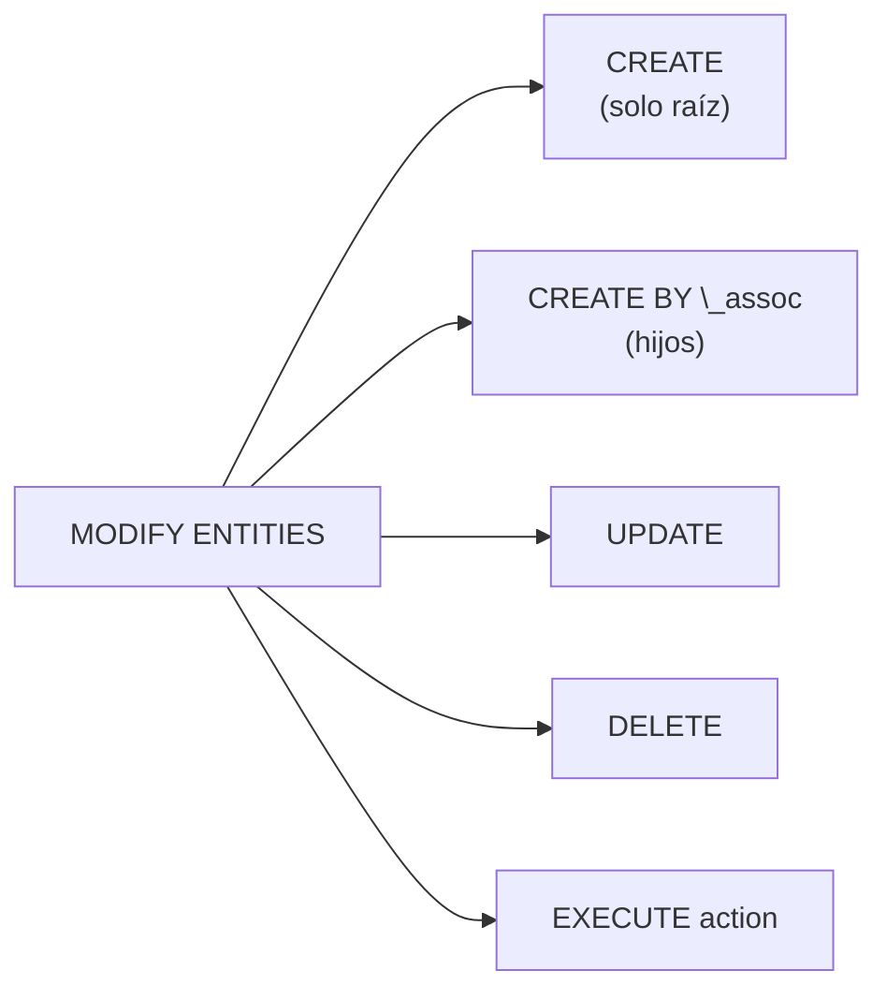

```
MODIFY ENTITIES OF <BO raíz> [IN LOCAL MODE]
  ENTITY <alias>
    UPDATE FIELDS ( Estado )
    WITH VALUE #( FOR key IN keys ( %tky = key-%tky  Estado = 'A' ) )
  FAILED … MAPPED … REPORTED … .
```

**Reglas prácticas**

| ✅ / ⚠️ | Regla |
|---|---|
| ✅ | Indica los campos con **`FIELDS ( … ) WITH`** (o rellena `%CONTROL`). El resto queda inicial / sin tocar. |
| ⚠️ | **Evita `SET FIELDS WITH`**: no permite la comprobación estática de `readonly` y no puede poner campos a inicial. |
| ✅ | En `CREATE BY \_assoc` usa `%CID_REF` (padre nuevo) o la **clave del padre** (padre existente) + `%target` con los hijos. |
| ✅ | `AUTO FILL CID` → RAP rellena el `%CID`. |
| ✅ | Varias entidades en una sola sentencia: `ENTITY Cabecera … ENTITY Linea …`. |
| 🔧 | `MODIFY AUGMENTING ENTITIES` → solo en **proyecciones**, para completar/modificar la petición antes de pasarla al BO base. |

### 4.3 GET PERMISSIONS 🛡️

Pregunta **"¿puedo?"** antes de hacerlo: autorizaciones (global/instancia) y feature control de create, create-by-association, update, delete, actions y campos.

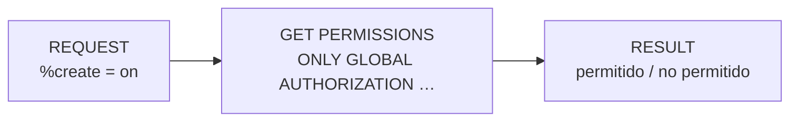

> Con `ONLY …` eliges qué se comprueba (global, instancia, features…).

### 4.4 SET LOCKS 🔒

Bloquea **explícitamente** instancias de cualquier BO.

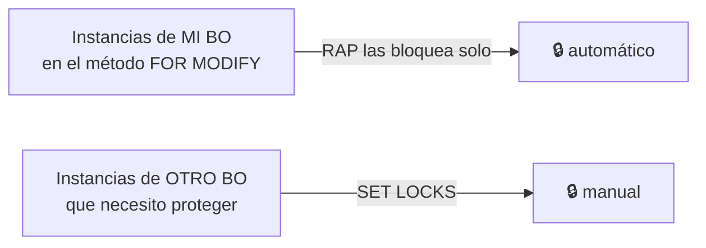

> ⚠️ Úsalo solo para lo que **no** bloquea ya RAP automáticamente.

### 4.5 COMMIT ENTITIES 💾

Dispara la **save sequence**: el buffer se graba en BD.

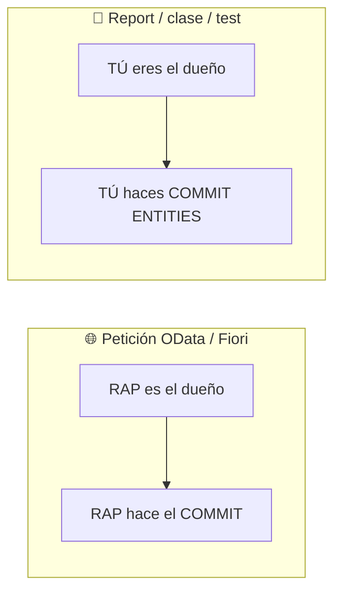

| Complemento | Para qué |
|---|---|
| `RESPONSE OF <BO>` | Recoger FAILED / REPORTED por BO |
| `IN SIMULATION MODE` | Ejecuta la save sequence (finalize, check_before_save, cleanup) **sin grabar**. Útil para validar desde apps no-RAP. |
| `CONVERT KEY` | Obtener la **clave final** (late numbering) de instancias de **otro** BO. Solo en la fase tardía del commit. |

> ⚠️ **Nunca** dentro de tu behavior implementation: allí manda RAP.

### 4.6 ROLLBACK ENTITIES ↩️

`ROLLBACK ENTITIES.` → vacía el buffer y vuelve al estado del último commit. También solo **fuera** del behavior pool.

---

## 5. Dónde se usa EML

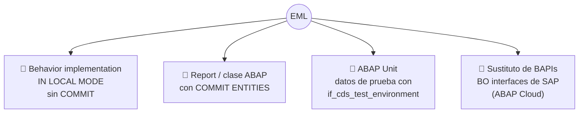

### Flujo típico en un report / clase

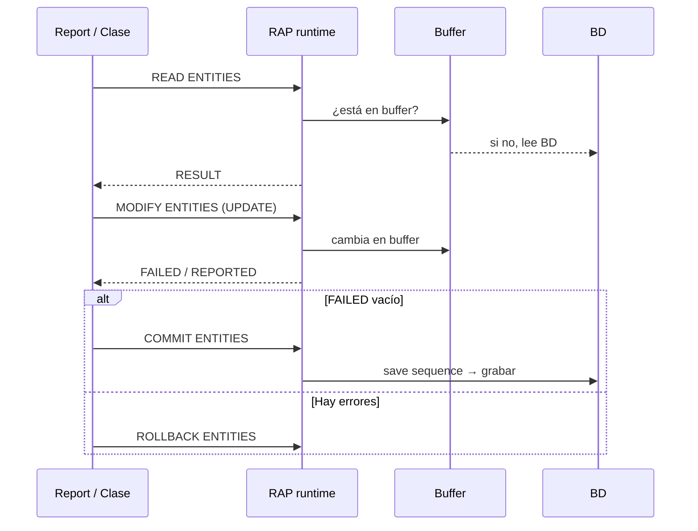

### EML como sustituto de BAPIs (ABAP Cloud) 🚀

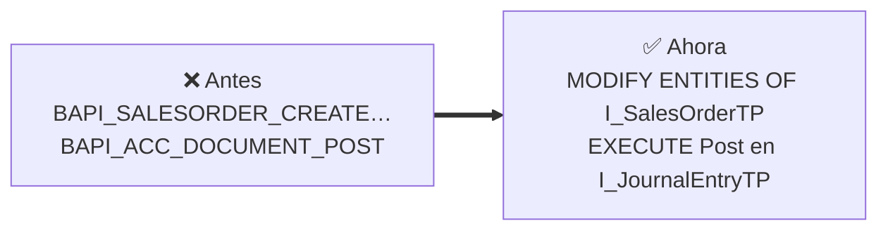

- SAP publica **business object interfaces** (`…TP`) como sucesores de las BAPIs.
- Una sola sentencia crea **cabecera + posiciones + textos** enlazados con `%CID` / `%CID_REF`.
- ⚠️ Algunas interfaces **no** ofrecen create/update/delete, solo **actions/functions** (p. ej. `I_JournalEntryTP`: `Post`, `Reverse`, `Change`, `Validate`).

---

## 6. EML vs. SQL — cuándo usar cada uno

| | `SELECT` (SQL/CDS) | `READ ENTITIES` (EML) |
|---|---|---|
| Lee de… | Base de datos | **Buffer transaccional** (y si no, BD) |
| ¿Ve cambios no grabados? | ❌ | ✅ |
| Filtros libres | ✅ | ❌ (por claves) |
| Respeta lógica del BO | ❌ | ✅ |
| Escritura | ❌ (prohibido en RAP) | ✅ `MODIFY ENTITIES` |
| Ideal para… | Informes, búsquedas masivas | Lógica de negocio dentro de la transacción |

---

## 7. ⚠️ Errores típicos

| ❌ Error | ✅ Correcto |
|---|---|
| Usar `SELECT` en una validation para leer los datos que se están cambiando | `READ ENTITIES … IN LOCAL MODE` (lee el buffer) |
| Usar `%KEY` en un BO con draft | Usar `%TKY` |
| `COMMIT ENTITIES` dentro del behavior pool | Dejar que RAP haga el commit |
| Olvidar `COMMIT ENTITIES` en un report | Sin commit, nada se graba |
| No comprobar `FAILED` antes del commit | `IF failed IS INITIAL. COMMIT ENTITIES. ENDIF.` |
| Repetir el mismo `%CID` en una llamada | Un `%CID` único por instancia (o `AUTO FILL CID`) |
| `SET FIELDS WITH` | `FIELDS ( … ) WITH` |
| `IN LOCAL MODE` desde fuera del BO | Solo dentro de su propio behavior pool |

---

## 8. 🧩 Chuleta de una página

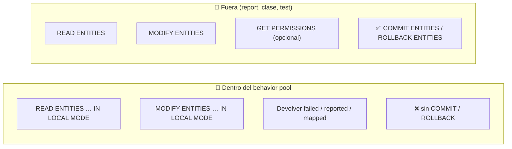

---

## 9. ✍️ Autoevaluación

1. ¿Por qué `READ ENTITIES` es mejor que `SELECT` dentro de una validation?
2. ¿Qué hace `IN LOCAL MODE` y dónde se puede usar?
3. ¿Para qué sirven `%CID` y `%CID_REF`? Pon un ejemplo con cabecera y líneas.
4. ¿Qué contiene `%TKY` y por qué se recomienda frente a `%KEY`?
5. ¿Qué parámetro de respuesta solo aparece en `MODIFY ENTITIES` y por qué?
6. ¿Quién hace el `COMMIT` en una app Fiori? ¿Y en un report?
7. ¿Cuándo tiene sentido `SET LOCKS`?
8. ¿Qué hace `COMMIT ENTITIES IN SIMULATION MODE`?
9. ¿Por qué no se recomienda `SET FIELDS WITH`?
10. Para añadir una línea a un gasto **ya existente**, ¿usas `%CID_REF` o la clave del padre?

<details>
<summary>Respuestas</summary>

1. Porque lee el buffer transaccional: ve los cambios aún no grabados.
2. Accede al BO saltándose autorizaciones, feature control y restricciones de campo. Solo dentro del behavior pool del propio BO.
3. `%CID` = clave temporal de una instancia nueva; `%CID_REF` = referencia a ese `%CID` desde otra instancia (p. ej. la línea apunta a la cabecera nueva).
4. `%KEY` + `%IS_DRAFT` + `%PID`. El código funciona con o sin draft y con o sin late numbering.
5. `MAPPED`: es cuando se crean instancias y hay que devolver la relación `%CID` → clave real.
6. Fiori/OData: RAP. Report: tú, con `COMMIT ENTITIES`.
7. Para bloquear instancias de otros BO que RAP no bloquea automáticamente.
8. Ejecuta la save sequence (finalize, check_before_save, cleanup) sin grabar.
9. No permite la comprobación estática de `readonly` y no permite poner campos a valor inicial.
10. La clave del padre (ya existe); `%CID_REF` es para padres creados en la misma llamada.

</details>

---

### 👉 Siguiente paso

El **capítulo 5 (Behavior Implementation)** usa todo esto dentro de los métodos `FOR MODIFY`, `FOR READ`, `FOR DETERMINE`, `FOR VALIDATE`… y del saver.
