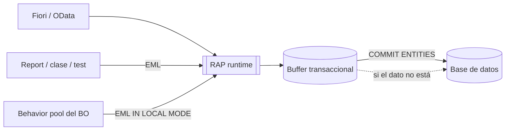
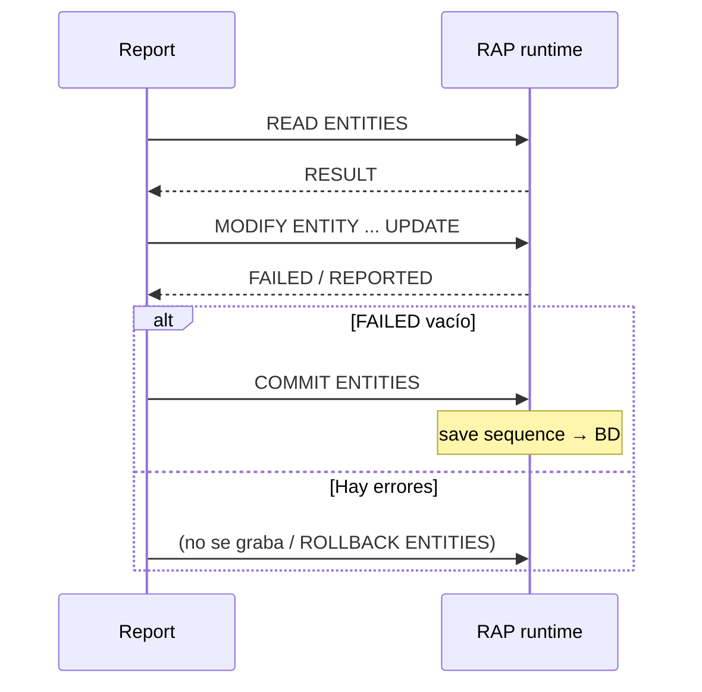
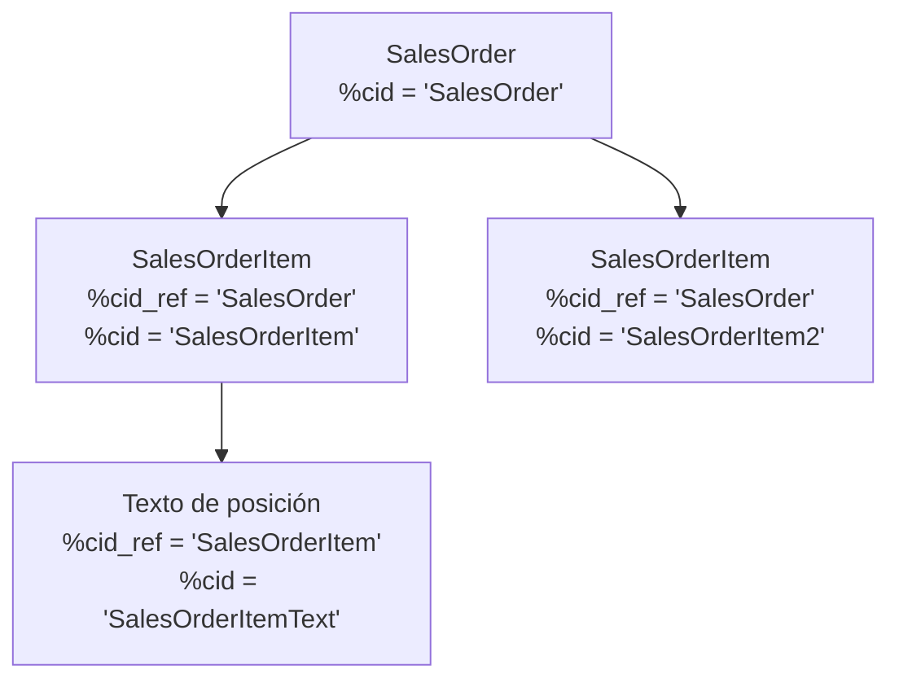

# Capítulo 4 — Entity Manipulation Language (EML)

> Resumen en español del capítulo 4 de *ABAP RESTful Application Programming Model*, 2ª ed. (Rheinwerk, 2025).
> Los términos técnicos se mantienen en inglés, tal como aparecen en ADT y en la documentación de SAP.
> Los fragmentos de código proceden de los listados del libro (recortados cuando son largos).

---

## Índice

1. [¿Qué es EML?](#1-qué-es-eml)
2. [Tipos de datos (4.1)](#2-tipos-de-datos-41)
3. [Operaciones EML (4.2)](#3-operaciones-eml-42)
4. [EML fuera de la behavior implementation (4.3)](#4-eml-fuera-de-la-behavior-implementation-43)
5. [Casos reales: pedido de venta con I_SalesOrderTP (4.4)](#5-casos-reales-pedido-de-venta-con-i_salesordertp-44)
6. [Errores típicos](#6-errores-típicos)
7. [Autoevaluación](#7-autoevaluación)

---

## 1. ¿Qué es EML?

El **Entity Manipulation Language (EML)** es una parte del lenguaje ABAP que permite acceder a los business objects RAP de forma **tipada**. Normalmente un BO se consume desde fuera vía OData (Fiori, API web); EML ofrece ese mismo acceso directamente desde ABAP.

Ideas básicas:

- EML **dispara las operaciones del BO**. Solo se puede usar una operación si está **declarada en la behavior definition** e implementada.
- Es **masivo**: toda operación trabaja con tablas de instancias, tanto en lectura como en escritura (aunque sea una sola instancia).
- Sirve para **leer y escribir**. Basta con que las entidades CDS estén en la behavior definition; **no** hacen falta service definition ni service binding.

### Doble uso

| Uso | Perspectiva | Ejemplo |
|---|---|---|
| Implementar el comportamiento del BO | Interna (*provider*) | Validations, determinations, actions |
| Acceder al BO desde fuera | Externa (*consumer*) | Report, otra aplicación, test ABAP Unit |

El capítulo se centra en la perspectiva interna.

### `IN LOCAL MODE`

- Solo se puede usar cuando el código está **dentro de la behavior implementation del propio BO**.
- Accede al BO **sin comprobar** access control, authorization control ni dynamic feature control.

### EML frente al acceso directo a base de datos

La gran ventaja de EML es que trabaja sobre el **buffer transaccional**: se ven datos que todavía **no se han grabado** en BD. Además:

- Con `BY \asociación` se lee y escribe en entidades dependientes, de forma coherente con lo modelado en la BDEF (padre e hijos se graban juntos).
- Permite operaciones **entre distintos BO**.



---

## 2. Tipos de datos (4.1)

### 2.1 Tipos derivados

El compilador ABAP **deriva tipos** a partir de las entidades CDS y la BDEF, de forma que los parámetros quedan tipados con referencia a cada entidad. Además de los campos de la entidad, incluyen componentes técnicos que empiezan por **`%`** (para no chocar con los campos propios).

| Componente | Significado |
|---|---|
| `%CID` | **Content ID**: clave temporal de una instancia mientras no tenga clave definitiva. La asigna el llamante en cada `create`. Permite identificar la instancia creada y relacionar instancias padre-hijo (p. ej. creación profunda con numeración interna o tardía). |
| `%CID_REF` | Referencia a un `%CID`. Se usa para apuntar a una instancia recién creada que aún no tiene clave definitiva. El libro lo resume así: `%CID` = clave transaccional, `%CID_REF` = clave foránea transaccional. |
| `%KEY` | Campos de clave primaria de la entidad. |
| `%TKY` | **Clave transaccional**: todos los campos clave + componentes derivados (`%IS_DRAFT` en escenarios draft, `%PID` con late numbering). |
| `%PID` | ID provisional con late numbering. Válido hasta que se asigna la clave final en `ADJUST_NUMBERS`. |
| `%PKY` | Clave usada en las tablas de respuesta (aparece junto a `%KEY` y `%TKY`). |
| `%IS_DRAFT` | Indica si la instancia es draft o activa. |
| `%CONTROL` | Un flag (tipo `ABP_BEHV_FLAG`) por campo: qué campos envía el consumidor (create/update) o qué campos pide (read). |
| `%DATA` | Todos los campos de datos de la entidad. |
| `%PARAM` | Tipo de entrada/resultado de una action o function. |
| `%FAIL` | Causa del fallo de una instancia. |
| `%MSG` | Mensaje: instancia de la interfaz `IF_ABAP_BEHV_MESSAGE`. |
| `%ELEMENT` | Estructura con todos los elementos de la entidad; marca a qué campo se refiere un mensaje. |

> Práctica habitual (no del libro, pero coherente con él): usar `%TKY` en lugar de `%KEY`. Así el código funciona igual con o sin draft y con o sin late numbering.

### 2.2 Parámetros de retorno implícitos: FAILED, REPORTED, MAPPED

Los métodos de los handlers (interacción y grabación) tienen parámetros de retorno implícitos. Se pueden declarar en la firma con el tipo genérico **`DATA`**; el tipo real lo pone el compilador según la BDEF.

Los tres son **tablas anidadas con una tabla por entidad** de la BDEF.

| Parámetro | Para qué sirve | Se identifica con |
|---|---|---|
| `FAILED` | Qué instancias han fallado | `%CID`, `%TKY`, `%KEY`, `%PKY` + `%FAIL` |
| `REPORTED` | Mensajes por instancia, reutilizables por el consumidor | `%CID`, `%TKY`, `%KEY`, `%PKY` + `%MSG`, `%ELEMENT` |
| `MAPPED` | Qué clave se ha asignado a cada `%CID` creado. El runtime usa estas claves en las llamadas siguientes de la misma petición/respuesta | `%CID`, `%TKY`, `%KEY`, `%PKY` |

---

## 3. Operaciones EML (4.2)

Una operación EML es un acceso de lectura o escritura a las entidades de un BO. Qué parámetros rellena cada una (tabla 4.1 del libro):

| Operación | FAILED | MAPPED | REPORTED |
|---|:-:|:-:|:-:|
| `READ ENTITIES` | X | – | X |
| `MODIFY ENTITIES` | X | X | X |
| `GET PERMISSIONS` | X | – | X |
| `SET LOCKS` | X | – | X |
| `COMMIT ENTITIES` | X | – | X |
| `ROLLBACK ENTITIES` | X | – | X |

`MAPPED` solo aparece en `MODIFY`, porque es la única que crea instancias.

### 3.1 READ ENTITIES

Lectura de instancias a partir de sus claves. Es la operación base que proporciona los datos para la lógica de negocio.

- Lee del **buffer transaccional**; si el dato no está ahí, lo lee de BD.
- A diferencia de `SELECT SINGLE`, devuelve el **estado actual** de la aplicación, no lo grabado.
- Para selecciones por cualquier criterio de filtro se siguen usando entidades CDS.
- **Managed**: RAP lee el buffer. **Unmanaged**: hay que implementarlo en el método `FOR READ` (cap. 5).

Sintaxis general:

```abap
READ ENTITIES OF root_name
  ENTITY entity_1_name
    FROM it_instance
      RESULT it_result
    BY \assoc_name FROM it_instance_rba
      RESULT it_result_rba
      LINK   it_link_rba
    EXECUTE action_name FROM it_instance_a
      RESULT it_result_a
  ENTITY entity_name_2 ...
  [FAILED it_failed]
  [REPORTED it_reported].
```

| Variante | Para qué |
|---|---|
| `FIELDS ( … ) WITH` / `ALL FIELDS WITH` | Leer campos de instancias concretas |
| `BY \_asociacion` | **Read-by-association**: leer instancias enlazadas (p. ej. los hijos) |
| `LINK` | Obtener la relación origen ↔ destino de la asociación |
| `EXECUTE` | Ejecutar una operación de lectura (function) |

Ejemplo de lectura de campos (método `copy_travel`):

```abap
READ ENTITIES OF /dmo/i_travel_m IN LOCAL MODE
  ENTITY travel
    FIELDS ( travel_id agency_id customer_id booking_fee total_price currency_code )
    WITH CORRESPONDING #( keys )
  RESULT   DATA(lt_read_result)
  FAILED   failed
  REPORTED reported.
```

Ejemplo de read-by-association: se leen los precios de las reservas para sumar el total del viaje (método `reCalcTotalPrice`):

```abap
READ ENTITIES OF /DMO/I_Travel_D IN LOCAL MODE
  ENTITY Travel BY \_Booking
    FIELDS ( FlightPrice CurrencyCode )
  WITH VALUE #( ( %tky = <fs_travel>-%tky ) )
  RESULT DATA(lt_booking).
```

El libro señala que este patrón sirve en cualquier relación padre-hijo, por ejemplo para calcular el estado de cabecera de un pedido a partir de los estados de sus posiciones.

### 3.2 MODIFY ENTITIES

Escritura sobre instancias indicando sus claves. Permite llamar a las operaciones estándar o a actions.

```abap
MODIFY ENTITIES OF root_name
  ENTITY entity_1_name
    CREATE FROM it_instance
    CREATE BY \assoc_name FROM it_instance_cba
    UPDATE FROM it_instance_u
    DELETE FROM it_instance_d
    EXECUTE action_name FROM it_instance_a [RESULT it_result_a]
  ENTITY entity_2_name ...
  [FAILED it_failed]
  [MAPPED it_mapped]
  [REPORTED it_reported].
```

Tras `ENTITY` se indica el **alias** de la entidad definido en la BDEF.

#### Create

Tras `CREATE FIELDS ( … )` se listan los campos que se rellenan; **el resto queda inicial**.

```abap
MODIFY ENTITIES OF /dmo/i_travel_m IN LOCAL MODE
  ENTITY travel
    CREATE FIELDS ( travel_id agency_id customer_id begin_date end_date
                    booking_fee total_price currency_code description overall_status )
    WITH lt_create
  MAPPED mapped FAILED failed REPORTED reported.
```

#### Create-by-association

Se usa siempre que hay asociación, y es clave en las **composiciones**, porque la entidad hija no puede existir sola (cabecera/posición). Los hijos se pasan en `%target`, y el enlace con el padre recién creado se hace con `%cid_ref`.

```abap
MODIFY ENTITIES OF /DMO/I_Travel_D
  ENTITY Travel
    CREATE FIELDS ( CustomerID AgencyID BeginDate EndDate Description ) WITH create
    CREATE BY \_Booking
      FIELDS ( CustomerID AirlineID ConnectionID FlightDate )
      WITH VALUE #( ( %cid_ref = 'create_travel'
                      %target  = VALUE #(
                        ( %cid = 'create_booking_1' %is_draft = if_abap_behv=>mk-off ... )
                        ( %cid = 'create_booking_2' %is_draft = if_abap_behv=>mk-off ... ) ) ) )
  MAPPED DATA(mapped) REPORTED DATA(reported) FAILED DATA(failed).
```

#### Update

Se identifica la instancia con `%tky` y se indican los campos que cambian (método `acceptTravel`):

```abap
MODIFY ENTITIES OF /DMO/I_Travel_D IN LOCAL MODE
  ENTITY Travel
    UPDATE FIELDS ( OverallStatus )
    WITH VALUE #( FOR key IN keys ( %tky          = key-%tky
                                    OverallStatus = travel_status-accepted ) ).
```

> **`SET FIELDS WITH` ya no se recomienda.** Con esa variante no se puede comprobar estáticamente el `readonly` y no se pueden poner campos a valor inicial. Es preferible `FIELDS ( … ) WITH` o rellenar `%CONTROL`.

#### Delete

```abap
MODIFY ENTITIES OF /DMO/I_Travel_D
  ENTITY TRAVEL
    DELETE FROM VALUE #( ( TravelUUID = lv_travel_id
                           %is_draft  = if_abap_behv=>mk-off ) )
  FAILED DATA(failed) REPORTED DATA(reported).
```

El libro lo usa, por ejemplo, en una clase de test para probar el borrado.

#### Execute (actions)

Ejecuta una action declarada en la BDEF. En el ejemplo, la action **interna** `reCalcTotalPrice` (método `calculateTotalPrice`):

```abap
MODIFY ENTITIES OF /DMO/I_Travel_D IN LOCAL MODE
  ENTITY Travel
    EXECUTE reCalcTotalPrice
    FROM CORRESPONDING #( keys )
  REPORTED DATA(lt_reported).
```

#### `AUTO FILL CID`

En `create` y create-by-association, rellena el `%CID` automáticamente y evita tener que inventar textos:

```abap
MODIFY ENTITIES OF i_salesordertp
  ENTITY salesorder
    CREATE AUTO FILL CID
    FIELDS ( salesordertype salesorganization distributionchannel organizationdivision soldtoparty )
    WITH VALUE #( ( %data = VALUE #( salesordertype = 'TA' salesorganization = '1010' ... ) ) )
  MAPPED DATA(ls_mapped) FAILED DATA(ls_failed) REPORTED DATA(ls_reported_modify).
```

#### `MODIFY AUGMENTING ENTITIES`

Variante especial que **solo se usa en proyecciones**. Sirve para añadir datos o modificar la petición entrante antes de pasarla al BO base. Solo se pueden cambiar entidades del BO subyacente; se permiten todas las operaciones estándar y actions. Con `RELATING TO … BY …` se relacionan las operaciones añadidas con las de la petición original.

```abap
MODIFY AUGMENTING ENTITIES OF /DMO/I_Supplement
  ENTITY SupplementText
    UPDATE FROM supplementtext_update
    RELATING TO entities_update BY relates_update
  ENTITY Supplement
    CREATE BY \_SupplementText
    FROM suppltext_for_existing_suppl
    RELATING TO entities_update BY relates_cba.
```

### 3.3 GET PERMISSIONS

Comprueba **antes de ejecutar** si se tienen los permisos necesarios. Se puede consultar:

- Autorización **global** y **de instancia** (cap. 3, §14).
- **Feature control** de create, create-by-association, update y delete (cap. 3, §17.1).
- También autorizaciones de actions propias y de campos.

```abap
GET PERMISSIONS [PRIVILEGED] [only_clause] OF bdef
  ENTITY bdef1 [FROM keys] REQUEST request RESULT result
  [ENTITY bdef2 ...]
  [response_param].
```

Con la cláusula `ONLY …` se elige qué se comprueba (p. ej. solo la autorización global). Ejemplo: ¿puede el usuario crear viajes?

```abap
DATA request_ga TYPE STRUCTURE FOR PERMISSIONS REQUEST /DMO/I_Travel_D.
request_ga-%create = if_abap_behv=>mk-on.

GET PERMISSIONS ONLY GLOBAL AUTHORIZATION ENTITY /DMO/I_Travel_D
  REQUEST request_ga
  RESULT DATA(result)
  FAILED DATA(failed)
  REPORTED DATA(reported).
```

### 3.4 SET LOCKS

Pone un **bloqueo explícito** sobre instancias de cualquier BO.

- Normalmente no hace falta: RAP bloquea automáticamente todas las instancias que aparecen en los métodos `FOR MODIFY`.
- Su uso es proteger instancias de **otros** BO que la aplicación necesita indirectamente.
- Se puede llamar desde cualquier aplicación, sin relación con el BO bloqueado.

```abap
SET LOCKS OF /DMO/I_Travel_M
  ENTITY TRAVEL FROM VALUE #( ( Travel_ID = '00000001' ) )
  FAILED DATA(lt_failed)
  REPORTED DATA(lt_reported).
```

> El libro advierte que debe usarse **solo** para instancias que no están en el método `FOR MODIFY` actual.

### 3.5 COMMIT ENTITIES

Dispara la **save sequence**: el buffer transaccional se graba en BD para todos los BO modificados en la LUW actual.

**Quién hace el commit**: el **dueño de la transacción**.

| Contexto | Dueño | ¿Hay que escribir `COMMIT ENTITIES`? |
|---|---|---|
| Servicio OData basado en RAP (Fiori, API) | RAP | No |
| Report, clase, test (fuera de la behavior implementation) | El propio programa | **Sí**, o no se graba nada |

```abap
COMMIT ENTITIES
  [RESPONSE OF root_name_1 [FAILED it_failed] [REPORTED it_reported]]
  [RESPONSE OF root_name_2 ...].
```

| Complemento | Qué hace |
|---|---|
| `RESPONSE OF <BO>` | Recoge FAILED/REPORTED por cada BO |
| `IN SIMULATION MODE` | Ejecuta la save sequence en modo prueba, **sin grabar**: métodos FINALIZE, CHECK_BEFORE_SAVE y CLEANUP o CLEANUP_FINALIZE. No hay `COMMIT WORK` implícito. Uso típico: una aplicación no RAP que modifica datos y tiene su propia lógica de grabación |
| `CONVERT KEY` | Obtiene la **clave final** asignada en `ADJUST_NUMBERS` a una instancia de un BO **ajeno** (no del propio). Solo en la fase tardía del commit, cuando ya existen las claves finales |

### 3.6 ROLLBACK ENTITIES

```abap
ROLLBACK ENTITIES.
```

Resetea el buffer transaccional al estado del último `COMMIT ENTITIES`. Igual que el commit, **solo se usa fuera** de la behavior implementation.

> Para saber qué parámetros debe rellenar el provider y cuáles recibe el consumer en cada situación, el libro remite al **RAP business object contract** en el SAP Help Portal.

---

## 4. EML fuera de la behavior implementation (4.3)

### 4.1 En un report

El libro muestra un report sencillo: si se marca un parámetro, lee el viaje y lo muestra en ALV; si no, actualiza la descripción, hace commit y vuelve a leer.

Puntos a destacar del listado:

- Existe la **forma corta `MODIFY ENTITY <entidad>`** (una sola entidad, sin `ENTITY` posterior).
- Se comprueba `FAILED` antes de grabar.

```abap
MODIFY ENTITY /DMO/I_Travel_U
  UPDATE FIELDS ( memo )
  WITH VALUE #( ( travelid = pa_trav  memo = pa_desc ) )
  FAILED   DATA(ls_failed)
  REPORTED DATA(ls_reported).

IF ls_failed IS INITIAL.
  COMMIT ENTITIES.          " arranca la save sequence → FINALIZE ...
ENDIF.
```

> En un report los cambios **siempre** deben cerrarse con `COMMIT ENTITIES`, porque no forman parte de la behavior implementation.



### 4.2 En una clase de test ABAP Unit

EML también se usa en los tests. En el ejemplo del libro:

1. Se preparan datos de prueba (`travel_id = '110'`) y se insertan en el entorno de test (`if_cds_test_environment`, método `insert_test_data`).
2. Se leen con `READ ENTITIES`.
3. Se compara el resultado con `cl_abap_unit_assert=>assert_equals`.

```abap
mo_test_environment->insert_test_data( i_data = mt_read_travel ).

READ ENTITIES OF /DMO/I_Travel_U
  ENTITY travel ALL FIELDS WITH
    VALUE #( ( %key-TravelID = mt_read_travel[ 1 ]-travel_id ) )
  RESULT DATA(lt_read_travel)
  FAILED DATA(ls_failed)
  REPORTED DATA(reported).

cl_abap_unit_assert=>assert_equals( act = lt_read_travel[ 1 ]-travelid
                                    exp = '110'
                                    msg = 'Error reading the data.' ).
```

La clase completa (`ztc_eml_travel`) está en el material descargable del libro.

---

## 5. Casos reales: pedido de venta con I_SalesOrderTP (4.4)

### 5.1 Crear un pedido completo en una sola sentencia

Una sola `MODIFY ENTITIES` crea **cabecera + posiciones + texto de posición**. Las instancias se enlazan con `%CID` / `%CID_REF`:



Reglas que muestra el ejemplo:

- El `%CID` puede ser **cualquier texto**, pero **único** dentro de la sentencia.
- Cada hijo pone en `%CID_REF` el `%CID` de su padre y recibe un `%CID` propio.
- Como aún no hay número de pedido ni de posición, los campos clave del padre se pasan con valor **`space`** (`salesorder = space`, `salesorderitem = space`).
- El texto se crea desde la entidad `SalesOrderItem` con `CREATE BY \_ItemText`.
- Del mismo modo se pueden añadir más entidades (p. ej. interlocutores de cabecera o posición).

```abap
MODIFY ENTITIES OF i_salesordertp
  ENTITY salesorder
    CREATE FIELDS ( salesordertype salesorganization distributionchannel
                    organizationdivision soldtoparty )
    WITH VALUE #( ( %cid = 'SalesOrder'
                    %data = VALUE #( salesordertype = 'TA' salesorganization = '1010' ... ) ) )
    CREATE BY \_item
      FIELDS ( product requestedquantity )
      WITH VALUE #( ( %cid_ref   = 'SalesOrder'
                      salesorder = space
                      %target    = VALUE #( ( %cid = 'SalesOrderItem'  product = 'TG11' requestedquantity = '10' )
                                            ( %cid = 'SalesOrderItem2' product = 'TG12' requestedquantity = '10' ) ) ) )
  ENTITY SalesOrderItem
    CREATE BY \_ItemText
      FIELDS ( LongText LanguageForEdit LongTextIDForEdit )
      WITH VALUE #( ( %cid_ref = 'SalesOrderItem'
                      salesorder = space  salesorderitem = space
                      %target = VALUE #( ( %cid = 'SalesOrderItemText'
                                           LanguageForEdit = 'D' LongTextIDForEdit = '0001'
                                           longtext = 'Text created' ) ) ) )
  MAPPED DATA(ls_mapped) FAILED DATA(ls_failed) REPORTED DATA(ls_reported_modify).
```

### 5.2 Modificar el pedido

Un único `MODIFY ENTITIES` con un bloque `ENTITY … UPDATE` por nivel:

| Entidad | Campo cambiado | Clave indicada en `%key` |
|---|---|---|
| `salesorder` | `purchaseorderbycustomer` | `salesorder` |
| `salesorderitem` | `requestedquantity` | `salesorder` + `salesorderitem` |
| `salesorderitemtext` | `longtext` | `salesorder` + `salesorderitem` + `language` + `longtextid` |

El número de pedido se completa con ceros a la izquierda mediante `|{ iv_salesorder ALPHA = IN }|`.

### 5.3 Añadir una posición a un pedido existente

Como el pedido **ya existe**, el enlace no se hace con `%CID_REF`, sino directamente con la **clave del padre**:

```abap
MODIFY ENTITIES OF i_salesordertp
  ENTITY SalesOrder
    CREATE BY \_item
      FIELDS ( product requestedquantity )
      WITH VALUE #( ( %key-salesorder = |{ iv_salesorder ALPHA = IN }|
                      salesorder      = |{ iv_salesorder ALPHA = IN }|
                      %target = VALUE #( ( %cid = 'SalesOrderItem1'
                                           product = 'TG13' requestedquantity = '10' ) ) ) )
  FAILED DATA(ls_failed) REPORTED DATA(ls_reported).
```

| Padre… | Cómo enlazar al hijo |
|---|---|
| Creado en la misma sentencia | `%CID_REF` = `%CID` del padre |
| Ya existente | Clave del padre (`%key-…`) |

### 5.4 EML como sucesor de las BAPIs

- Los BO RAP y las **business object interfaces** de SAP (`…TP`) sustituyen a las llamadas BAPI, también para contabilizaciones complejas (detalle en cap. 6, §6.6).
- En **ABAP Cloud** este enfoque es cada vez más importante: SAP publica numerosas interfaces como sucesoras de las BAPIs clásicas.
- Su contenido **no siempre coincide** con el de la BAPI anterior. Algunas solo ofrecen actions/functions. Ejemplo: `I_JournalEntryTP` **no** tiene create/update/delete, solo:

```abap
define behavior for I_JournalEntryTP alias JournalEntry
{
  use action   Post;
  use action   Reverse;
  use function Validate;
  use action   Change;
}
```

---

## 6. Errores típicos

| Error | Forma correcta |
|---|---|
| Leer con `SELECT` en una validation los datos que se están modificando | `READ ENTITIES … IN LOCAL MODE` (lee el buffer) |
| Escribir `COMMIT ENTITIES` / `ROLLBACK ENTITIES` dentro de la behavior implementation | Lo hace RAP; solo se usan fuera |
| Olvidar `COMMIT ENTITIES` en un report | Sin commit no se graba nada |
| Hacer el commit sin mirar `FAILED` | `IF failed IS INITIAL. COMMIT ENTITIES. ENDIF.` |
| Repetir un `%CID` en la misma sentencia | `%CID` único por instancia, o `AUTO FILL CID` |
| Usar `SET FIELDS WITH` | `FIELDS ( … ) WITH` o `%CONTROL` |
| Usar `IN LOCAL MODE` desde fuera del BO | Solo dentro de su propia behavior implementation |
| `%CID_REF` para añadir un hijo a un padre que ya existe | Clave del padre |
| `SET LOCKS` sobre instancias del propio `FOR MODIFY` | Ya las bloquea RAP; `SET LOCKS` es para otros BO |
| `CONVERT KEY` sobre el propio BO | Solo para BO ajenos, en la fase tardía del commit |

---

## 7. Autoevaluación

1. ¿Qué ventaja tiene `READ ENTITIES` frente a `SELECT SINGLE` dentro de la lógica del BO?
2. ¿Qué comprobaciones omite `IN LOCAL MODE` y dónde se puede usar?
3. ¿Qué diferencia hay entre `%CID` y `%CID_REF`?
4. ¿Qué contiene `%TKY`?
5. ¿Qué parámetro de retorno solo rellena `MODIFY ENTITIES` y por qué?
6. ¿Cómo se declaran FAILED/REPORTED/MAPPED en la firma de un método y quién los tipa?
7. ¿Quién hace el commit en un servicio OData RAP? ¿Y en un report?
8. ¿Qué métodos de la save sequence se ejecutan con `COMMIT ENTITIES IN SIMULATION MODE`?
9. ¿Por qué no se recomienda `SET FIELDS WITH`?
10. Al crear un pedido con posiciones en una sola sentencia, ¿qué valor llevan los campos clave del padre en las posiciones?
11. ¿Cuándo tiene sentido `SET LOCKS`?
12. ¿Qué particularidad tiene `I_JournalEntryTP` respecto a una BAPI clásica?

<details>
<summary>Respuestas</summary>

1. Lee el buffer transaccional: devuelve el estado actual, incluidos cambios aún no grabados.
2. Access control, authorization control y dynamic feature control. Solo dentro de la behavior implementation del propio BO.
3. `%CID` es la clave temporal de una instancia nueva; `%CID_REF` es la referencia a ese `%CID` desde otra instancia (clave foránea transaccional).
4. Los campos clave más los componentes derivados: `%IS_DRAFT` (draft) y `%PID` (late numbering).
5. `MAPPED`: es la única operación que crea instancias y debe devolver qué clave corresponde a cada `%CID`.
6. Con el tipo genérico `DATA`; el compilador ABAP los tipa según la behavior definition.
7. OData: RAP, como dueño de la transacción. Report: el propio report, con `COMMIT ENTITIES`.
8. FINALIZE, CHECK_BEFORE_SAVE y CLEANUP o CLEANUP_FINALIZE, sin grabar y sin `COMMIT WORK` implícito.
9. Impide comprobar estáticamente el `readonly` y no permite poner campos a valor inicial.
10. `space`, porque todavía no existe número de pedido.
11. Para bloquear instancias de otros BO que la aplicación necesita indirectamente y que RAP no bloquea por sí mismo.
12. No ofrece create/update/delete; solo actions (`Post`, `Reverse`, `Change`) y la function `Validate`.

</details>

---

**Siguiente:** capítulo 5 (Behavior Implementation), donde EML se usa dentro de los métodos `FOR MODIFY`, `FOR READ`, `FOR DETERMINE`, `FOR VALIDATE` y en el saver.
